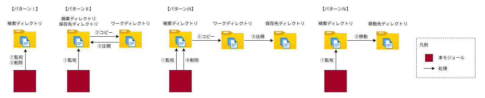
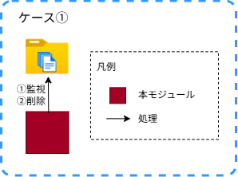
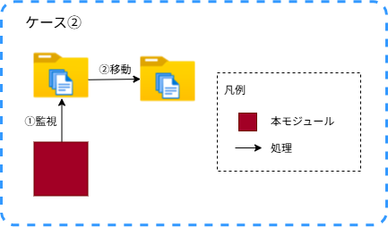
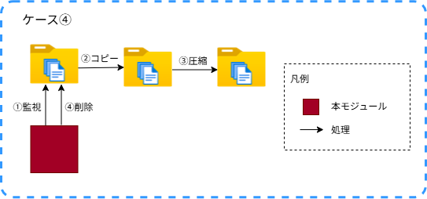

# FileCleaner

## 目次
* [概要](#概要)
* [機能](#機能)
  * [※経過時間の判定方法について](#JudgeMethod)
* [Quick Start](#quick-start)
* [イメージのURL](#イメージのurl)
* [動作保証環境](#動作保証環境)
* [Deployment 設定値](#deployment-設定値)
  * [環境変数](#環境変数)
  * [Desired Properties](#desired-properties)
  * [Create Option](#create-option)
  * [startupOrder](#startuporder)
* [受信メッセージ](#受信メッセージ)
* [送信メッセージ](#送信メッセージ)
  * [Message Body](#message-body)
  * [Message Properties](#message-properties)
* [Direct Method](#direct-method)
  * [SetLogLevel](#setloglevel)
  * [GetLogLevel](#getloglevel)
* [ログ出力内容](#ログ出力内容)
* [ユースケース](#ユースケース)
  * [ケース ①](#Usecase1)
  * [ケース ②](#Usecase2)
  * [ケース ③](#Usecase3)
* [Feedback](#feedback)
* [LICENSE](#license)

## 概要
FileCleanerは、フォルダ/ファイルを監視し、移動/削除/圧縮を起動時間、一定間隔で実行するAzure IoT edgeモジュールです。

## 機能

指定した期間経過したファイル／ディレクトリを、削除／圧縮／圧縮して削除／移動する。  

* パターンⅠ：処理対象の検索ディレクトリを指定して、ファイルまたはディレクトリの削除を行う。  
* パターンⅡ：処理対象の検索ディレクトリおよび圧縮ファイルの保存先ディレクトリを指定して、ファイルまたはディレクトリの圧縮を行う。  
* パターンⅢ：処理対象の検索ディレクトリおよび圧縮ファイルの保存先ディレクトリを指定して、ファイルまたはディレクトリの圧縮を行い、元ファイルを削除する。  
* パターンⅣ：処理対象の検索ディレクトリおよび移動先ディレクトリを指定して、ファイルまたはディレクトリの移動を行う。  

各処理は、実行する日時や間隔を指定することができる。  
オプションで、ファイル検索方法や上書き制御を指定することができる。  
また、処理対象の絞込みを行ったり、圧縮後のファイル名を指定したりすることができる。  



<a id="JudgeMethod"></a>

### ※経過時間の判定方法について

* "update_time"の場合

  現在日時から設定された経過時間をマイナスした日時 >= ファイルの更新日時 の場合に対象とする<br>
  例) "day"=1 "hour"=6、現在日時が「2020/10/20 14:00:00」の場合、<br>
  「2020/10/19 8:00:00」>= ファイルの更新日時 の場合対象<br>

<br>

* "name_prefix"の場合
  * ファイルの先頭8文字が、指定された日付形式("yyyyMMdd"形式等)で日付に変換可能な物が対象
  * 現在日時から設定された経過時間をマイナスした日時の年月日 >= ファイルの先頭文字 の場合に対象とする<br>
    例) "hour"=12、現在日時が「2020/10/20 14:00:00」の場合、<br>
    判定日時「2020/10/20 2:00:00」<br>
    → ファイルの先頭文字が"20201020"以前のファイルが対象<br>
    "day"=1、 現在日時が「2020/10/20 14:00:00」の場合、<br>
    判定日時「2020/10/19 14:00:00」<br>
    → ファイルの先頭文字が"20201019"以前のファイルが対象<br>

## Quick Start
1. Personal Access tokenを作成
（参考: [個人用アクセス トークンを管理する](https://docs.github.com/ja/authentication/keeping-your-account-and-data-secure/managing-your-personal-access-tokens)）

2. リポジトリをクローン
```
git clone https://github.com/Project-GAUDI/FileCleaner.git
```

3. ./src/nuget_template.configの<GITHUB_USERNAME>と<PERSONAL_ACCESS_TOKEN>を自身のユーザー名とPersonal Access tokenに書き換えて、ファイル名をnuget.configに変更してください

4. Dockerイメージをビルド
```
docker image build -t <IMAGE_NAME> ./FileCleaner/src/
```
例）
```
docker image build -t ghcr.io/<YOUR_GITHUB_USERNAME>/filecleaner:<VERSION> ./FileCleaner/src/
```

5. Dockerイメージをコンテナレジストリにプッシュ
```
docker push <IMAGE_NAME>
```
例）
```
docker push ghcr.io/<YOUR_GITHUB_USERNAME>/filecleaner:<VERSION>
```

6. Azure IoT edgeで利用

## イメージのURL
準備中

| URL                                                         | Description         |
| ----------------------------------------------------------- | ------------------- |

## 動作保証環境

| Module Version | IoTEdge | edgeAgent | edgeHub | amd64 verified on | arm64v8 verified on | arm32v7 verified on |
| -------------- | ------- | --------- | ------- | ----------------- | ------------------- | ------------------- |
| 7.0.1          | 1.6.4   | 1.6.4     | 1.6.4   | ubuntu24.04       | －                  | －                  |

## Deployment 設定値

### 環境変数

#### 環境変数の値

| Key               | Type   | Required | Conditions                                  | Default | Description                     |
| ----------------- | ------ | -------- | ------------------------------------------- | ------- | ------------------------------- |
| TransportProtocol | string |          | ["Amqp", "Mqtt"]                            | Amqp    | ModuleClient の接続プロトコル。 |
| LogLevel          | string |          | ["trace", "debug", "info", "warn", "error"] | info    | 出力ログレベル。                |

### Desired Properties

#### Desired Properties の値

| JSON Key                           | Type    | Required | Conditions                                                                                                                                                                                                                                      | Default            | Description                                                                                                                                                                                                                                  |
| ---------------------------------- | ------- | -------- | ----------------------------------------------------------------------------------------------------------------------------------------------------------------------------------------------------------------------------------------------- | ------------------ | -------------------------------------------------------------------------------------------------------------------------------------------------------------------------------------------------------------------------------------------- |
| info[x]                            | object  | 〇       | [x]は連番の数字                                                                                                                                                                                                                                 |                    | 実行する処理の情報。                                                                                                                                                                                                                         |
| &emsp; job_name                    | string  |          |                                                                                                                                                                                                                                                 | null               | 処理名。ログ出力時に使用。                                                                                                                                                                                                                   |
| &emsp; timezone                    | string  |          |                                                                                                                                                                                                                                                 | "UTC"              | 起動スケジュール：タイムゾーン。<br>ホスト環境のタイムゾーンと合わせることを推奨。<br>推奨値は"Asia/Tokyo"。                                                                                                                                 |
| &emsp; second                      | string  | 〇       |                                                                                                                                                                                                                                                 |                    | 起動スケジュール：秒(cron式)。                                                                                                                                                                                                               |
| &emsp; minute                      | string  | 〇       |                                                                                                                                                                                                                                                 |                    | 起動スケジュール：分(cron式)。                                                                                                                                                                                                               |
| &emsp; hour                        | string  | 〇       |                                                                                                                                                                                                                                                 |                    | 起動スケジュール：時(cron式)。                                                                                                                                                                                                               |
| &emsp; day                         | string  | 〇       |                                                                                                                                                                                                                                                 |                    | 起動スケジュール：日(cron式)。                                                                                                                                                                                                               |
| &emsp; month                       | string  | 〇       |                                                                                                                                                                                                                                                 |                    | 起動スケジュール：月(cron式)。                                                                                                                                                                                                               |
| &emsp; week                        | string  | 〇       |                                                                                                                                                                                                                                                 |                    | 起動スケジュール：週(cron式)。                                                                                                                                                                                                               |
| &emsp; mode                        | string  | 〇       | ["delete", "compress", "compress_and_delete", "move"]                                                                                                                                                                                           |                    | 実行モード。<br>delete：削除<br>compress：圧縮(zipのみ)、元ファイルは残る<br>compress_and_delete：圧縮(zipのみ)して元ファイルを削除<br>move：移動                                                                                            |
| &emsp; target_type                 | string  | 〇       | ["file", "directory"]                                                                                                                                                                                                                           |                    | 処理対象の種類。<br>file：ファイル<br>directory：ディレクトリ                                                                                                                                                                                |
| &emsp; search_option               | string  |          | target_type=file時のみ有効<br>["TopDirectoryOnly", "AllDirectories"]                                                                                                                                                                            | "TopDirectoryOnly" | ファイル検索オプション。<br>TopDirectoryOnly：処理対象の検索ディレクトリ直下のみ検索<br>AllDirectories：サブディレクトリも含めて検索<br>target_type=directoryの場合、<br>処理対象の検索ディレクトリ直下のディレクトリのみ検索。              |
| &emsp; move_overwrite              | boolean |          | mode=move時のみ有効                                                                                                                                                                                                                             | true               | 移動時、移動先に同名ファイル(ディレクトリ)が存在する場合、<br>上書きするかどうか。<br>true：上書きする<br>false：上書きしない                                                                                                                |
| &emsp; input_path                  | string  | 〇       | input_path/output_path/comp_workpathの<br>包含関係の制約 ※1                                                                                                                                                                                     |                    | 処理対象の検索ディレクトリ。                                                                                                                                                                                                                 |
| &emsp; output_path                 | string  | △        | mode=compress/compress_and_delete/move時必須<br>mode=compress/compress_and_deleteの場合、<br>input_pathと同じでもOK<br>mode=moveの場合、input_pathと大文字小文字区別せず同じはNG<br>input_path/output_path/comp_workpathの<br>包含関係の制約 ※1 |                    | mode=compress/compress_and_deleteの場合、<br>圧縮ファイルの保存先ディレクトリ。<br>mode=moveの場合、移動先ディレクトリ。                                                                                                                     |
| &emsp; comp_workpath               | string  | △        | mode=compress/compress_and_delete時必須<br>input_path/output_pathと大文字小文字区別せず同じはNG<br>input_path/output_path/comp_workpathの<br>包含関係の制約 ※1                                                                                  |                    | 圧縮時に使用するワークディレクトリ。                                                                                                                                                                                                         |
| &emsp; regex_pattern               | string  |          |                                                                                                                                                                                                                                                 | null               | 処理対象とするファイル名(ディレクトリ名)の正規表現パターン。<br>省略した場合、全てのファイル名(ディレクトリ名)が処理対象となる。                                                                                                             |
| &emsp; elapsed_time                | object  |          |                                                                                                                                                                                                                                                 | null               | 処理対象とする経過日数。<br>省略した場合、経過日数にかかわらず、<br>全てのファイル(ディレクトリ)が処理対象となる。                                                                                                                           |
| &emsp; &emsp; judge_type           | string  | △        | elapsed_time設定時必須<br>["update_time", "name_prefix", "name_regex"]                                                                                                                                                                          |                    | 経過日数の判定の種類。<br>update_time：ファイル(ディレクトリ)の更新日時で判定<br>name_prefix：ファイル名(ディレクトリ名)の<br>先頭から取得した文字列で判定<br>name_regex：ファイル名(ディレクトリ名)の<br>group_nameから取得した文字列で判定 |
| &emsp; &emsp; group_name           | string  |          | judge_type=name_regex時のみ有効                                                                                                                                                                                                                 | null               | regex_patternの正規表現パターンで指定された、<br>日付部分を示す文字列のグループ名。                                                                                                                                                          |
| &emsp; &emsp; date_format          | string  |          | judge_type=name_prefix/name_regex時のみ有効                                                                                                                                                                                                     | "yyyyMMdd"         | 経過日数の判定のために取得した文字列の日時書式指定文字列。※2<br>judge_type="name_prefix"の利用例は、ユースケース②を参照。<br>judge_type="name_regex"の利用例は、ユースケース③を参照。                                                        |
| &emsp; &emsp; day                  | number  |          | day/hour/minute/secondのうち1つ以上指定<br>0以上の整数                                                                                                                                                                                          | 0                  | 経過日数：日。<br>現在時刻を基準に、day日以前が処理対象となる。                                                                                                                                                                              |
| &emsp; &emsp; hour                 | number  |          | day/hour/minute/secondのうち1つ以上指定<br>0以上の整数                                                                                                                                                                                          | 0                  | 経過日数：時。<br>現在時刻を基準に、hour時間以前が処理対象となる。                                                                                                                                                                           |
| &emsp; &emsp; minute               | number  |          | day/hour/minute/secondのうち1つ以上指定<br>0以上の整数                                                                                                                                                                                          | 0                  | 経過日数：分。<br>現在時刻を基準に、minute分以前が処理対象となる。                                                                                                                                                                           |
| &emsp; &emsp; second               | number  |          | day/hour/minute/secondのうち1つ以上指定<br>0以上の整数                                                                                                                                                                                          | 0                  | 経過日数：秒。<br>現在時刻を基準に、second秒以前が処理対象となる。                                                                                                                                                                           |
| &emsp; compress_file               | object  |          | mode=compress/compress_and_delete時のみ有効                                                                                                                                                                                                     | null               | 圧縮ファイル名の情報。 <br>省略した場合、圧縮元のファイル名(ディレクトリ名)となる。                                                                                                                                                          |
| &emsp; &emsp; filename             | string  | △        | compress_file設定時必須                                                                                                                                                                                                                         |                    | 圧縮ファイルのファイル名。拡張子は含めない。<br>拡張子は固定で".zip"が付与される。                                                                                                                                                           |
| &emsp; &emsp; replace_param[y]     | object  |          | [y]は連番の数字                                                                                                                                                                                                                                 | null               | 圧縮ファイル名の置換設定。                                                                                                                                                                                                                   |
| &emsp; &emsp; &emsp; base_name     | string  | △        | replace_param設定時必須                                                                                                                                                                                                                         |                    | 置換前文字列。                                                                                                                                                                                                                               |
| &emsp; &emsp; &emsp; replace_type  | string  | △        | replace_param設定時必須<br> ["group_name", "file_date", "now_date"]                                                                                                                                                                             |                    | 置換後文字列の種類。<br>group_name：regex_patternの正規表現で指定されたグループ名<br>から取得した値に置換<br>file_date：圧縮するファイル(ディレクトリ)の更新日時に置換<br>now_date：現在日時に置換                                           |
| &emsp; &emsp; &emsp; replace_value | string  | △        | replace_param設定時必須<br>replace_type=group_nameの場合、<br>正規表現のグループ名を指定<br>replace_type=file_date/now_dateの場合、<br>ToStringする際のフォーマットを指定 ("yyyyMMdd"等)                                                        |                    | 置換後文字列の取得に使用。                                                                                                                                                                                                                   |

※1 input_path/output_path/comp_workpathの包含関係の制約  

* target_type=directoryの場合、input_path/output_pathに包含関係があるとNG  

* target_type=fileかつsearch_option=AllDirectoriesの場合、input_path/output_pathに包含関係があるとNG  

* mode=compressまたはcompress_and_deleteの場合、input_path/comp_workpathまたはoutput_path/comp_workpathに包含関係があるとNG  

※2 日時書式指定文字列  

* 記法  
  [https://learn.microsoft.com/ja-jp/dotnet/standard/base-types/standard-date-and-time-format-strings (外部リンク)](https://learn.microsoft.com/ja-jp/dotnet/standard/base-types/standard-date-and-time-format-strings)

#### Desired Properties の記入例

```json
{
  "info1": {
    "job_name": "val20 Backup Zip Delete",
    "timezone": "Asia/Tokyo",
    "second": "0",
    "minute": "0/5",
    "hour": "*",
    "day": "*",
    "month": "*",
    "week": "?",
    "mode": "delete",
    "target_type": "file",
    "input_path": "/iotedge/val20/Backup",
    "regex_pattern": "^val20-\\d{6}\\.zip$",
    "elapsed_time": {
      "judge_type": "update_time",
      "day": 365
    }
  }
}
```

### Create Option

#### Create Option の値

| JSON Key     | Type   | Required | Description                                                  |
| ------------ | ------ | -------- | ------------------------------------------------------------ |
| HostConfig   | object | ○        |                                                              |
| &emsp; Binds | array  | ○        | ホスト上のディレクトリとコンテナーのディレクトリのマッピング |

#### Create Option の記入例

記入の仕方は、"ホスト側のディレクトリパス:コンテナー側のディレクトリパス"の形式。  
設定するディレクトリパスは、3種類。（実行モードによっては、設定不要なディレクトリパスもある）  

```json
{
  "HostConfig": {
    "Binds": [
      "{処理対象の検索ディレクトリ}:{モジュールツイン：input_path}",
      "{圧縮ファイル保存先ディレクトリ／移動先ディレクトリ}:{モジュールツイン：output_path}",
      "{圧縮時に使用するワークディレクトリ}:{モジュールツイン：comp_workpath}"
    ]
  }
}
```

記入例

```json
{
  "HostConfig": {
    "Binds": [
      "/var/ftp/val20/input:/iotedge/val20/input",
      "/var/ftp/val20/output:/iotedge/val20/output",
      "/var/ftp/val20/comp_work:/iotedge/val20/comp_work"
    ]
  }
}
```

### startupOrder

#### startupOrder の値

| JSON Key     | Type   | Required | Conditions                   | Default    | Recommend | Description                                            |
| ------------ | ------ | -------- | ---------------------------- | ---------- | --------- | ------------------------------------------------------ |
| startupOrder | number |          | 0 以上 4294967295 以下の整数 | 4294967295 | 400       | モジュールの起動順序。数字が小さいほど先に起動される。 |

#### startupOrder の記入例

```json
{
  "startupOrder": 400
}
```

## 受信メッセージ

なし

## 送信メッセージ

普段はメッセージを送信しないが、モジュールのエラーが発生した場合にメッセージ送信が行われる。
送信にあたってのアウトプット名は固定で変更不可能。  

例)

```plantext
FROM /messages/modules/<送信元Container名>/outputs/log INTO BrokeredEndpoint(\"/modules/<送信先Container名>/inputs/<input名>\")
```

### Message Body

| JSON Key     | Type         | Description |
| ------------ | ------------ | ----------- |
| RecordHeader | string array |             |
| &emsp; [0]   | string       | 処理時刻    |
| RecordData   | string array | エラー内容  |

### Message Properties

| Key   | Description                       |
| ----- | --------------------------------- |
| type  | メッセージのタイプ ("log"固定)    |
| level | ログのレベル (errorのため"3"固定) |

### Message の例

```json
{
  "Body": {
    "RecordHeader": ["2025-09-04 15:28:21.873 +09:00"],
    "RecordData": ["<3> 2025-09-04 15:28:21.873 +09:00 [ClassName]Log message"]
  },
  "Properties": {
    "type": "log",
    "level": "3"
  }
}
```

## Direct Method

### SetLogLevel

* 機能概要

  実行中に一時的にLogLevelを変更する。<br>
  変更はモジュール起動中または有効時間を過ぎるまで有効。<br>

* payload

  | JSON Key      | Type    | Required | default | Description |
  | ------------- | ------- | -------- | -------- | ----------- |
  | EnableSec     | integer  | 〇       |          | 有効時間(秒)。<br>-1:無期限<br>0:リセット(環境変数LogLevel相当に戻る)<br>1以上：指定時間(秒)経過まで有効。  |
  | LogLevel      | string  | △       |          | EnableSec=0以外を指定時必須。指定したログレベルに変更する。<br>["trace", "debug", "info", "warn", "error"]  |

  １時間"trace"レベルに変更する場合の設定例

  ```json
  {
    "EnableSec": 3600,
    "LogLevel": "trace"
  }
  ```

* response

  | JSON Key      | Type    | Description |
  | ------------- | ------- | ----------- |
  | status          | integer | 処理ステータス。<br>0:正常終了<br>その他:異常終了         |
  | payload          | object  | レスポンスデータ。         |
  | &nbsp; CurrentLogLevel | string  | 設定後のログレベル。（正常時のみ）<br>["trace", "debug", "info", "warn", "error"]  |
  | &nbsp; Error | string  | エラーメッセージ（エラー時のみ）  |

  ```json
  {
    "status": 0,
    "paylaod":
    {
      "CurrentLogLevel": "trace"
    }
  }
  ```

### GetLogLevel

* 機能概要

  現在有効なLogLevelを取得する。<br>
  通常は、LogLevel環境変数の設定値が返り、SetLogLevelで設定した有効時間内の場合は、その設定値が返る。<br>

* payload

  なし

* response

  | JSON Key      | Type    | Description |
  | ------------- | ------- | ----------- |
  | status          | integer | 処理ステータス。<br>0:正常終了<br>その他:異常終了         |
  | payload          | object  | レスポンスデータ。         |
  | &nbsp; CurrentLogLevel | string  | 現在のログレベル。（正常時のみ）<br>["trace", "debug", "info", "warn", "error"]  |
  | &nbsp; Error | string  | エラーメッセージ（エラー時のみ）  |

  ```json
  {
    "status": 0,
    "paylaod":
    {
      "CurrentLogLevel": "trace"
    }
  }
  ```

## ログ出力内容

| LogLevel | 出力概要                                                                                                                                                                                               |
| -------- | ------------------------------------------------------------------------------------------------------------------------------------------------------------------------------------------------------ |
| error    | [初期化/モジュールツイン更新/実行]失敗<br>[環境変数/モジュールツイン]の必須項目未設定<br>[環境変数/モジュールツイン]がConditionsまたはType制約違反                                                     |
| warn     | 無し                                                                                                                                                                                                   |
| info     | [環境変数/モジュールツイン]の値<br>モジュールツイン更新通知<br>[環境変数/モジュールツイン]の省略可能項目未設定のためDefault値適用<br>スケジューラー[開始/停止]<br>実行[開始/停止]<br>ジョブ[開始/停止] |
| debug    | ジョブ待機<br>同一ジョブ実行中<br>処理対象日時がnull<br>スケジューラー動作チェック<br>出力先の圧縮ファイルチェック                                                                                     |
| trace    | メソッドの開始・終了                                                                                                                                                                                   |

## ユースケース

<a id="Usecase1"></a>

### ケース ①

指定したディレクトリに存在する所定のファイル名のファイルを、保存して365日以上経過したら削除する。  



#### 起動順序 startupOrder

| 名称         | 値  |
| ------------ | --- |
| startupOrder | 400 |

#### 環境変数

| 名称     | 値    |
| -------- | ----- |
| LogLevel | debug |

#### コンテナーの作成オプション Create Option

```json
{
  "HostConfig": {
    "Binds": [
      "/var/ftp/val20/Backup:/iotedge/val20/Backup"
    ]
  }
}
```

#### モジュールツインの設定 Desired Properties

```json
{
  "info1": {
    "job_name": "val20 Backup Zip Delete",
    "timezone": "Asia/Tokyo",
    "second": "0",
    "minute": "0/5",
    "hour": "*",
    "day": "*",
    "month": "*",
    "week": "?",
    "mode": "delete",
    "target_type": "file",
    "input_path": "/iotedge/val20/Backup",
    "regex_pattern": "^val20-\\d{6}\\.zip$",
    "elapsed_time": {
      "judge_type": "update_time",
      "day": 365
    }
  }
}
```

#### 入力内容

`/var/ftp/val20/Backup`ディレクトリに以下のファイルを保存する。  

* `val20-{任意の文字列(6文字)}.zip`  

#### 処理内容

ファイルを保存して365日経過後、ファイルが削除される。  
削除処理は、毎日5分おきに実行される。  

<a id="Usecase2"></a>

### ケース ②

指定したディレクトリに存在する所定のファイル名のファイルを、ファイル名に含まれる日付文字列から1日以上経過したら、別ディレクトリに移動する。  



#### 起動順序 startupOrder

| 名称         | 値  |
| ------------ | --- |
| startupOrder | 400 |

#### 環境変数

| 名称     | 値    |
| -------- | ----- |
| LogLevel | debug |

#### コンテナーの作成オプション Create Option

```json
{
  "HostConfig": {
    "Binds": [
      "/var/ftp/val20/Backup:/iotedge/val20/Backup",
      "/var/ftp/val20/Old:/iotedge/val20/Old"
    ]
  }
}
```

#### モジュールツインの設定 Desired Properties

```json
{
  "info1": {
    "job_name": "val20 Backup CSV Move",
    "timezone": "Asia/Tokyo",
    "second": "0",
    "minute": "5",
    "hour": "5",
    "day": "?",
    "month": "*",
    "week": "sun,tue-sat",
    "mode": "move",
    "target_type": "file",
    "input_path": "/iotedge/val20/Backup",
    "output_path": "/iotedge/val20/Old",
    "regex_pattern": "^\\d{6}_005_(007|025)_(J|j)(P|p)013010043010(3|4|5|6)_.+\\.(C|c)(S|s)(V|v)$",
    "elapsed_time": {
      "judge_type": "name_prefix",
      "date_format": "yyMMdd",
      "day": 1
    }
  }
}
```

#### 入力内容

`/var/ftp/val20/Backup`ディレクトリに以下のファイルを保存する。  

* {yyMMddの日付}_005_007_JP0130100430103_{任意の文字列}.CSV
* {yyMMddの日付}_005_007_jP0130100430104_{任意の文字列}.csv
* {yyMMddの日付}_005_007_Jp0130100430105_{任意の文字列}.CSV
* {yyMMddの日付}_005_007_jp0130100430106_{任意の文字列}.csv
* {yyMMddの日付}_005_025_jp0130100430103_{任意の文字列}.csv
* {yyMMddの日付}_005_025_jP0130100430104_{任意の文字列}.CSV
* {yyMMddの日付}_005_025_Jp0130100430105_{任意の文字列}.csv
* {yyMMddの日付}_005_025_JP0130100430106_{任意の文字列}.CSV

#### 処理内容

ファイル名に含まれるyyMMddの日付から1日経過したファイルが、`/var/ftp/val20/Old`ディレクトリに移動される。  
移動処理は、月曜日を除く05:05:00(日本時間)に実行される。  

### ケース3

指定したディレクトリに存在する所定のファイル名のファイルを、ファイル名に含まれる日付文字列から1日以上経過したら、圧縮して同じディレクトリに保存後、元ファイルを削除する。  


#### 起動順序 startupOrder

| 名称         | 値  |
| ------------ | --- |
| startupOrder | 400 |

#### 環境変数

| 名称     | 値    |
| -------- | ----- |
| LogLevel | debug |

#### コンテナーの作成オプション Create Option

```json
{
  "HostConfig": {
    "Binds": [
      "/var/ftp/val20/Backup:/iotedge/val20/Backup",
      "/var/ftp/val20/comp_work:/iotedge/val20/comp_work"
    ]
  }
}
```

#### モジュールツインの設定 Desired Properties

```json
{
  "info1": {
    "job_name": "val20 Backup CSV Compress",
    "timezone": "Asia/Tokyo",
    "second": "0",
    "minute": "5",
    "hour": "5",
    "day": "?",
    "month": "*",
    "week": "sun,tue-sat",
    "mode": "compress_and_delete",
    "target_type": "file",
    "input_path": "/iotedge/val20/Backup",
    "output_path": "/iotedge/val20/Backup",
    "comp_workpath": "/iotedge/val20/comp_work",
    "regex_pattern": "^TMP_005_(007|025)_(J|j)(P|p)013010043010(3|4|5|6)
                      _.+_(?<production_date>\\d{6})-\\d{4}\\.(C|c)(S|s)(V|v)_*[0-9]*$",
    "elapsed_time": {
      "judge_type": "name_regex",
      "group_name": "production_date",
      "date_format": "yyMMdd",
      "day": 1
    },
    "compress_file": {
      "filename": "val20-<production_date>",
      "replace_param1": {
        "base_name": "<production_date>",
        "replace_type": "group_name",
        "replace_value": "production_date"
      }
    }
  }
}
```

#### 入力内容

`/var/ftp/val20/Backup`ディレクトリに以下のファイルを保存する。  

* TMP_005_007_JP0130100430103_{任意の文字列}_{yyMMddの日付}-{4桁の文字}.CSV
* TMP_005_007_Jp0130100430104_{任意の文字列}_{yyMMddの日付}-{4桁の文字}.csv_1
* TMP_005_007_jP0130100430105_{任意の文字列}_{yyMMddの日付}-{4桁の文字}.CSV_2
* TMP_005_007_jp0130100430106_{任意の文字列}_{yyMMddの日付}-{4桁の文字}.csv_3
* TMP_005_025_jp0130100430103_{任意の文字列}_{yyMMddの日付}-{4桁の文字}.csv_4
* TMP_005_025_jP0130100430104_{任意の文字列}_{yyMMddの日付}-{4桁の文字}.CSV_5
* TMP_005_025_Jp0130100430105_{任意の文字列}_{yyMMddの日付}-{4桁の文字}.csv_6
* TMP_005_025_JP0130100430106_{任意の文字列}_{yyMMddの日付}-{4桁の文字}.CSV_7

#### 処理内容

ファイル名に含まれるyyMMddの日付から1日経過したファイルが`/var/ftp/val20/comp_work`ディレクトリにコピーされた後、圧縮され`val20-{yyMMddの日付}.zip`ファイルができる。  
圧縮されたファイル`val20-{yyMMddの日付}.zip`が`/var/ftp/val20/Backup`ディレクトリに保存された後、圧縮元ファイルが削除される。  
上記処理は、月曜日を除く05:05:00(日本時間)に実行される。  

### ケース4

指定したディレクトリ直下に存在する全てのディレクトリを、  
保存して7日以上経過したら、圧縮して別ディレクトリに保存後、元ディレクトリを削除する。  



#### 起動順序 startupOrder

| 名称         | 値  |
| ------------ | --- |
| startupOrder | 400 |

#### 環境変数

| 名称     | 値    |
| -------- | ----- |
| LogLevel | debug |

#### コンテナーの作成オプション Create Option

```json
{
  "HostConfig": {
    "Binds": [
      "/var/ftp/val20/Backup:/iotedge/val20/Backup",
      "/var/ftp/val20/Old:/iotedge/val20/Old",
      "/var/ftp/val20/comp_work:/iotedge/val20/comp_work"
    ]
  }
}
```

#### モジュールツインの設定 Desired Properties

```json
{
  "info1": {
    "job_name": "val20 Backup Directory Delete",
    "timezone": "Asia/Tokyo",
    "second": "0",
    "minute": "0/5",
    "hour": "*",
    "day": "*",
    "month": "*",
    "week": "?",
    "mode": "compress_and_delete",
    "target_type": "directory",
    "input_path": "/iotedge/val20/Backup",
    "output_path": "/iotedge/val20/Old",
    "comp_workpath": "/iotedge/val20/comp_work",
    "elapsed_time": {
      "judge_type": "update_time",
      "day": 7
    }
  }
}
```

#### 入力内容

`/var/ftp/val20/Backup`ディレクトリに任意のディレクトリを作成し、ディレクトリ内に任意のファイルを保存する。  

#### 処理内容

作成して7日経過したディレクトリが`/var/ftp/val20/comp_work`ディレクトリにコピーされた後、圧縮されて`<圧縮元ディレクトリ名>.zip`ファイルができる。  
圧縮されたファイル`<圧縮元ディレクトリ名>.zip`が`/var/ftp/val20/Old`ディレクトリに保存された後、圧縮元ディレクトリが削除される。  
上記処理は、毎日5分おきに実行される。  

## Feedback
お気づきの点があれば、ぜひIssueにてお知らせください。

## LICENSE
FileCleaner is licensed under the MIT License, see the [LICENSE](LICENSE) file for details.
